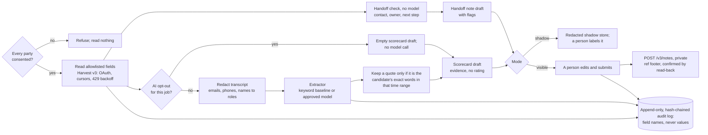

# handoff-copilot

A recruiter's screening-call copilot that drafts and never decides. It reads the call's transcript and fills the hiring signals your team defines, each backed by a quoted line checked word for word against what the candidate said. At the end it drafts two things for a person to submit:

- a **scorecard draft**: evidence only, with no rating field anywhere in the code;
- a **handoff note**: the canonical contact, the owner of record and the next step promised on the call, with a flag wherever the sources disagree.

Greenhouse is the first connector, built on the Harvest v3 API and tested against an in-process fake of it. The copilot rolls out in shadow first, then as visible drafts. There is no mode where it submits, rejects or rates anyone.

Python 3.11+, no runtime dependencies, MIT.

## How a screen flows



## Run it

```bash
python -m pip install -e ".[dev]"
handoff-copilot demo        # the whole walk-through on the synthetic org
pytest                      # 115 tests
```

The demo runs three synthetic screens in shadow, shows the promotion check refusing to promote with no human labels, then runs screen 7301 in visible mode, where a person submits both drafts. Excerpts from its output:

```text
1. Shadow: drafts nobody sees, nothing written to Greenhouse
   application 5101: 6 quotes kept, flags ['contact_mismatch', 'screened_by_non_owner', 'promise_without_schedule'], model step ran
   application 5102: 5 quotes kept, flags none, model step ran
   application 5103: 0 quotes kept, flags ['promise_without_schedule'], no model step (AI opt-out honored)
   Harvest writes during shadow: 0

   What the model was shown (redacted before the prompt):
     [142.3-158.0] candidate: Please use my personal email, t***@e***.net. The other address on my application is an old school account I don't check anymore.

   Dropped before you saw them: 1 not_candidate_speech, 1 not_in_transcript, 1 outside_time_range, 1 protected_topic, 1 unknown_signal

   Contact
     Use: taylor.b@example.net (stated by the candidate at 02:22)
   Next step
     Promised at 02:38: "Next step: I'll set up the hiring manager screen for Friday and send the invite to that address."
     On the calendar: nothing
   Check before you submit
     [contact_mismatch] the candidate stated taylor.b@example.net on the call; the profile has t.brightwater@example.com; the last logged email (2026-10-24) went to t.brightwater@example.com. Confirm before the next invite.
     [screened_by_non_owner] user #35 ran the screen and the recruiter of record is user #31. This note is the handoff.
     [promise_without_schedule] a next step was promised at 02:38 and no later interview is scheduled or waiting to be scheduled

   scorecard draft hc-59d387678382: the reply was lost, the read-back found it: delivered as note #8005
   copies of that note in Greenhouse: 1
   Feedback within 24 h: 2 of 5 due (1 late, 2 still missing)
   Screens with nothing next on the calendar after 48 h: 1 of 3 (applications [5101])
```

The visible run feeds the extractor a hand-written stand-in for a model's answer (`examples/model_output_7301.json`): five exact quotes plus one claim for each drop rule. It is not model output. To plug in a real endpoint, pass any `complete(prompt) -> str` to `PromptExtractor`. It only ever receives the redacted transcript.

Other commands: `handoff-copilot coverage`, `handoff-copilot gate REVIEWS.jsonl` (exits 1 until a person's labels clear the bars) and `handoff-copilot verify-audit PATH`.

## What it does, and the choice behind each part

**The handoff check runs first, and it uses no model.** At the end of a screen it compares what the candidate said on the call with the profile's addresses and the address on the latest logged email (`email_to` on `EMAIL` notes). It compares the person who ran the screen with the application's recruiter and coordinator, and the next step the interviewer promised with what's on the calendar. Each disagreement becomes a flag a person resolves: `contact_mismatch`, `contact_ambiguous`, `contact_missing`, `no_owner`, `screened_by_non_owner`, `promise_without_schedule`, `no_next_step`. It never edits the profile and never picks between two addresses itself.

**Quotes are checked, not trusted.** An extractor proposes `{signal, quote, starts, ends}`. `verify` keeps a claim only if the quote is an exact substring of the candidate's own lines in that time range. Whitespace is the only thing forgiven, not case and not paraphrase. Everything else is dropped with a reason the recruiter sees counted: `not_in_transcript`, `not_candidate_speech`, `outside_time_range`, `unknown_signal`, `too_short`, `too_long`, `protected_topic`, `duplicate`, `over_limit`. A schema can shape a model's output; only this check guarantees it.

**Nothing grades.** The scorecard draft has no rating field, and the connector never asks Greenhouse for `candidate_rating`. The rubric loader refuses signals that grade or decide (`rating`, `score`, `recommend`, `fit`, `risk` and more) and signals about protected topics (age, citizenship, family, salary history and more). Eligibility belongs to the application questions and HR, not to a model listening to a call. The copilot, the connector and the Harvest client have no method that rejects, moves, advances, hires or rates, and a test checks that.

**The model sees as little as possible.** No transcript is read without recorded consent from every party on the call (California requires all-party consent under Penal Code 632). A candidate's AI opt-out for the job (`GET /v3/ai_opt_out_statuses`) means no model call at all. The handoff note is still drafted, because it needs none. Harvest is asked for named `fields` only, and anything extra the server sends is dropped. Before any prompt, emails (written or spoken, as in "taylor dot b at example dot net"), phone numbers and every known name are masked, and speakers appear as `candidate` and `interviewer`.

**A person submits, once.** In visible mode the recruiter edits a draft and submits it, or discards it. It lands as a private note (`visibility: private`) authored by that person, with a `ref:` footer. Harvest documents no idempotency key for notes, so the connector looks for that ref before posting. When a reply is lost it reads the notes back instead of posting again, and it calls a draft delivered only once the read-back finds it.

**Shadow first, then visible drafts.** In shadow, drafts go to a local store with contacts and names masked. Nothing is shown and nothing reaches Greenhouse. A person lays the drafts beside what recruiters actually filed and labels each quote useful or wrong, each missed evidence line, and each flag real or false. `promotion_check` recommends visible drafts only when enough screens are reviewed and the Wilson lower bounds of quote precision, evidence recall and flag precision all clear their bars. The bars in `Bars` are placeholders to agree with TA ops.

**Measure coverage and what lands.** `metrics` computes the baseline from Greenhouse's own timestamps. Feedback filed within 24 hours of an interview ending uses Harvest's documented rule: owed feedback is an `interviewers` row with a `user_id` and no `scorecard_id`. There is no webhook for a submitted scorecard, so this comes from polling. Screens with nothing next on the calendar after 48 hours count candidates nobody followed up with. Drafts are counted as confirmed by read-back, not by jobs run.

**Every step leaves a receipt.** The audit log is SQLite with triggers that refuse `UPDATE` and `DELETE`, and each row's hash covers the row before it. Rows hold the actor, the action, record ids, the field names returned and a prompt hash, never field values. `append` refuses anything that looks like an email address or phone number.

## Greenhouse as one connector

`GreenhouseConnector` is written from Greenhouse's public Harvest v3 reference, checked on Nov 1, 2026. The v1/v2 API was removed on Aug 31, 2026.

| Concern | What the client does |
| --- | --- |
| Auth | OAuth 2.0 client credentials at `auth.greenhouse.io/token` (optional `sub`), bearer on `harvest.greenhouse.io/v3`; renews before `expires_in` and once on a 401 |
| Paging | Filters and `per_page` on the first request only, then the `Link: rel="next"` URL exactly, which carries only a cursor (mixing them returns 422) |
| Rate limits | Pauses until `X-RateLimit-Reset` when 10 or fewer requests remain; on 429 waits `Retry-After` plus jitter; token requests stay out of the Harvest window |
| Data | `fields=` allowlist per resource, enforced again client-side |
| Transcripts | `GET /v3/interview_media`; the signed `transcript_url` is fetched without the bearer token |
| Writes | `POST /v3/notes` with `note_type: NOTE`, `visibility: private`; nothing else |

Another ATS plugs in by implementing `screen_context` and `post_private_note` (`copilot.Connector`) and mapping its records to the same field names.

## What was tested

- **115 tests** (pytest), passing on Python 3.11, 3.12 and 3.13, with ruff lint and format checks. CI runs them, plus the demo and a detect-secrets scan, on every push.
- They cover:
  - every drop rule;
  - redaction of written and spoken addresses, and a prompt checked to hold no name, address or number from the synthetic profile;
  - each handoff flag;
  - token issue, renewal and the 401 retry;
  - cursor-only follow-up pages and the 422 for a mixed cursor;
  - 429 backoff and giving up, and the pause before the limit;
  - fields the server sends anyway being dropped;
  - no bearer token on the signed media URL;
  - a lost reply that doesn't double-post, and a lost write that isn't called delivered;
  - the consent gate reading nothing;
  - shadow writing nothing;
  - AI opt-out meaning no model call;
  - the audit chain catching an edit made around its triggers;
  - the promotion bars;
  - the coverage numbers on the synthetic org.
- I also broke five guards on purpose, one at a time: redaction before the prompt, the ref lookup before posting, the client-side field filter, exact-match quoting and the rate-limit pause. The suite failed each time. The field-filter break got through at first, because the fake already honored `fields=`. That gap led to the "fields the server sends anyway" test.
- Every test runs against `FakeHarvest`, an in-process fake built from the public reference, and a fake clock, so waits are asserted, not slept. The urllib transport is exercised against a local HTTP server.

## What this is not

- **Not tested against a Greenhouse account or sandbox.** It is tested against a fake written from the public docs. These are documented but unverified on a live org:
  - whether `email_to` is filled on logged emails;
  - how Notetaker labels speakers;
  - whether a `sub` token inherits that recruiter's permissions;
  - how `private` notes show to the hiring team.
- **Not used by a recruiter yet.** There are no adoption, accuracy, time-saved or latency numbers. The keyword baseline and the hand-written stand-in answer exercise the rules; they measure nothing about a model.
- **No audio capture.** It reads Notetaker-format transcripts (`{entries: [{speaker, text, starts, ends}]}`, seconds). Speaker roles come from the source's labels matched to the candidate's name, or a person sets them. There is no diarization.
- **No scorecard writes.** Whether an API-created draft scorecard opens in the interviewer's own form is unverified, so the scorecard draft lands as a private note and the interviewer writes the scorecard.
- **Not legal advice.** The design follows California's all-party consent rule and its employment automated-decision rules (effective Oct 1, 2025), which reach tools that support a person's decision. Counsel sets retention and signs off. The protected-topic word lists are a backstop, not a classifier.

## Why I built this

In October 2025 I was the candidate in a recruiting handoff that dropped facts. I was passed through four people before I reached the hiring manager. My résumé fell off one forwarded email thread, and my email got lost before my Friday hiring-manager screen, so the screen slipped.

The weekend of Oct 18–20, 2025, before the rescheduled call, I built a screening-call copilot. It kept one thread and one file store per candidate, transcribed the call live, backed five hiring signals with quoted lines and drafted a handoff note for the next recruiter. That prototype stays private. This repo is a clean rebuild on synthetic candidates and copies none of its code.

Looking back, the prototype got two things wrong. Its handoff note summarized the call but never checked the email, the field that cost me my screen; here the contact check runs first, with no model. And it carried a risk status and a routing recommendation; here nothing rates, ranks or routes anyone.

The rest comes from running my own funnel in 2026. In my junk-removal company's lead system, about 3% of qualified leads ever got a decision from a person, with a median wait of about 2 hours. A reminder job reported success every minute from Sep 17 while sending nothing. A recruiting funnel breaks in the same places: coverage, follow-up and handoffs. So this measures feedback filed within 24 hours and screens with nothing next on the calendar, and it confirms each draft by reading it back.

When I put an agent on those leads in October 2026, it ran in shadow first (Oct 9). It went live only behind a kill switch that was off by default (Oct 11), and its rails could only make a decision more cautious. The posture here is the same: shadow, then visible drafts, and no mode where it acts alone.

## Next

- **handoff-check:** the same handoff check at every reassignment, driven by Harvest webhooks (HMAC over the raw body, dedupe on `Greenhouse-Event-ID`) with an hourly `updated_at` reconcile, exposed as MCP tools.
- **An eval:** 20 scripted synthetic screens with a key I label myself, scoring the share of model quotes that verify and the share of labeled evidence lines found.
- **The sandbox checks** listed above, before anything says "tested on Greenhouse".
- **Other transcript sources** for screens without Notetaker: a browser capture and a listen-only phone fork, consent first.

## License

MIT. Every person, address, number and record in `examples/` is invented (example.com/.org/.net domains, 555-01xx numbers).
